# pvecenter — Management Panel for Proxmox VE 8.x / 9.x (PVE Web UI)

**English | [简体中文](README.md)**

[](LICENSE) [](../../releases) [](https://github.com/yjscloud/pvecenter/actions/workflows/ci.yml) [](../../stargazers) [](../../forks) [](../../issues)   

**pvecenter** is an open-source, self-hosted **Proxmox VE (PVE) web management panel**: one
interface for QEMU virtual machines, LXC containers, cloud-init templates, networking and firewall,
snapshots and backups, the VNC console, certificates and multi-user permissions. Install it as a
systemd service or run it with Docker — it comes back by itself after a reboot.

[Live demo](https://pvecenter.yjscloud.com) · [Screenshots](#screenshots) · [Key features](#key-features) ·
[Quick start](#1-deployment) · [Troubleshooting](#6-troubleshooting) · [简体中文](README.md)

Built for homelabs, small teams, and anyone who needs to open a PVE cluster to several people.

> Keywords: Proxmox VE panel · PVE panel · PVE web UI · LXC container management · QEMU / KVM ·
> cloud-init templates · self-hosted virtualization platform · Proxmox alternative UI · homelab ·
> self-hosted

## Contact and feedback

If you run into a problem, want to suggest a feature, or need help with a deployment, add me on
WeChat with the QR code below, or leave a note in [Issues](https://github.com/yjscloud/pvecenter/issues).
Some features have not been tested thoroughly yet — just say what broke, no need to be polite
about it.

pvecenter is maintained by one person. If it saved you some time, voluntary donations go towards
servers, test environments and ongoing maintenance; not donating has no effect at all on the project
or on support.

<table>
  <tr>
    <td align="center" width="33%"><br><sub><b>WeChat</b> · bugs / deployment help</sub></td>
    <td align="center" width="33%"><br><sub><b>WeChat tip</b> · voluntary</sub></td>
    <td align="center" width="33%"><br><sub><b>Alipay tip</b> · voluntary</sub></td>
  </tr>
</table>

## Screenshots

> Screenshots live in `docs/screenshots/`, preferably **1600×900** (16:9). The file names below can
> be replaced freely; while a file is missing GitHub shows the alt text, and the image appears as
> soon as you drop it in.

<!--
Placeholder list (each appears automatically once the file exists in docs/screenshots/):
vm-list.png / vm-create.png / lxc-list.png / template-pipeline.png / firewall.png /
ssh-security.png / security-baseline.png / ai-assistant.png / monitoring.png /
backup.png / console.png / audit-log.png / certificates.png / users-rbac.png
-->

<table>
  <tr>
    <td width="50%">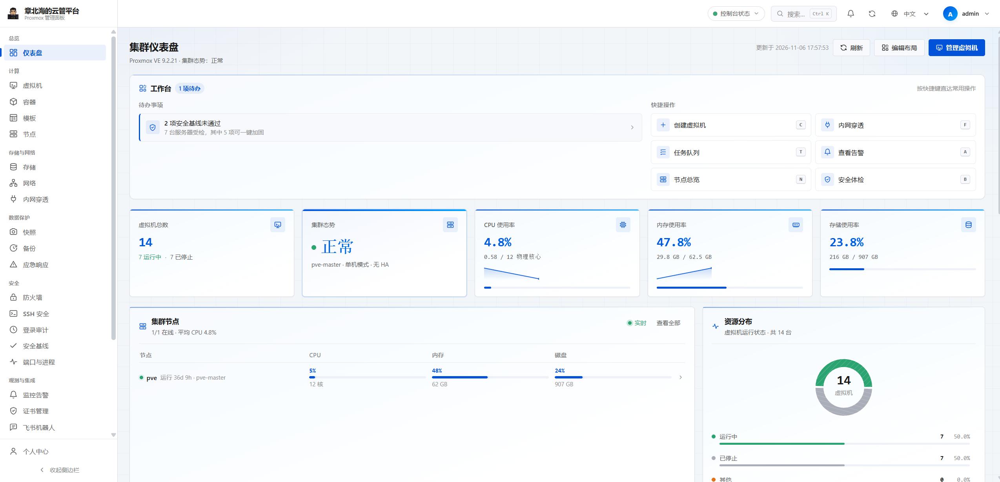<br><sub><b>Monitoring dashboard</b> · node status / resource usage / recent tasks</sub></td>
    <td width="50%">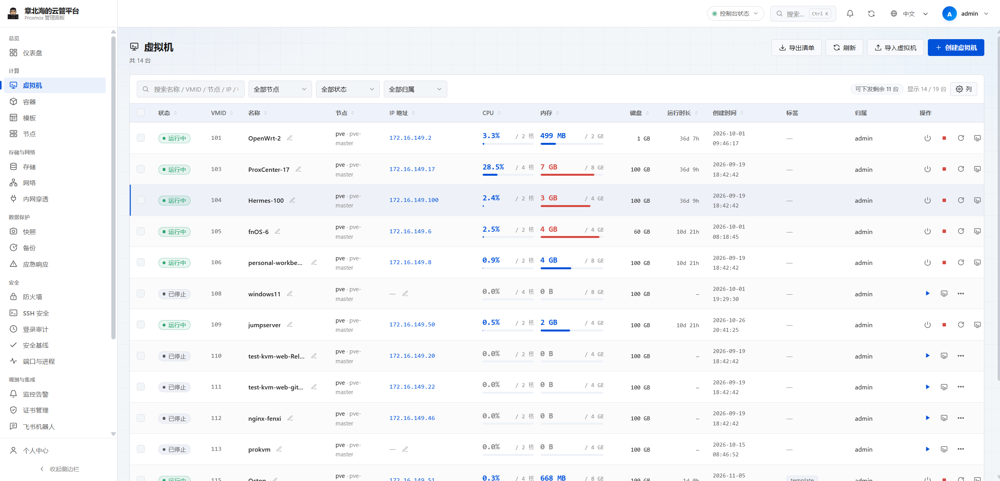<br><sub><b>Virtual machines</b> · batch actions / migration / quota</sub></td>
  </tr>
  <tr>
    <td width="50%">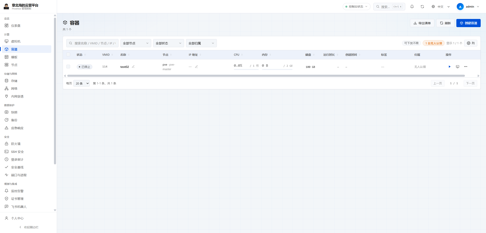<br><sub><b>LXC containers</b> · lifecycle / snapshots / migration</sub></td>
    <td width="50%">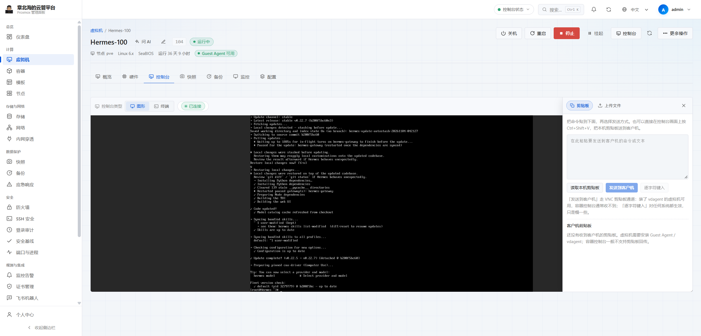<br><sub><b>VNC console</b> · drive it from the browser</sub></td>
  </tr>
</table>

## Key features

- **Virtual machines (QEMU / KVM)**: four-step creation, batch power operations, cloning, migration, disk resize, snapshots and backups
- **LXC containers**: create, start/stop, snapshots, cloning, migration, rootfs resize, console
- **cloud-init template pipeline**: build a template from a cloud image in one action, then inject hostname / SSH key / IP when cloning
- **Networking and firewall**: Linux bridge / bond / VLAN, PVE native firewall, security groups, IP sets
- **Monitoring and alerting**: live metrics, RRD charts, capacity forecasting, mail / Feishu notifications
- **Backup and restore**: back up now, scheduled jobs, browse backup volumes, restore to a given VMID, delete protection
- **Certificate management**: Tencent Cloud / Alibaba Cloud / Huawei Cloud / ACME / hosted certificates, automatic renewal, deployed to the local host, SSH hosts, PVE virtual machines / containers / nodes
- **Security operations**: SSH brute-force protection, login audit, security baseline, port and process inspection, emergency response
- **AI troubleshooting assistant**: correlates inspection data, read-only command allowlist, write commands approved one by one
- **Multi-user and audit**: RBAC, quotas, full operation audit, two-factor authentication

## Quick start

Install it as a systemd service so it comes back after a reboot:

```bash
git clone https://github.com/yjscloud/pvecenter.git
cd pvecenter
sudo ./deploy.sh
```

The last screen prints the panel address and the initial password, which is shown only once. Prefer
containers? See [Docker deployment](#docker-deployment); both routes are covered under
[1. Deployment](#1-deployment).

Stack: Python 3.11+ / FastAPI / httpx, React 18 + TypeScript + Vite, MySQL 8.

## Contents

- [Screenshots](#screenshots) · [Key features](#key-features)
- [1. Deployment](#1-deployment): [Create a token](#create-a-proxmox-api-token) · [Grant permissions](#grant-permissions) ·
  [Bare metal](#bare-metal-deployment-recommended) · [Docker](#docker-deployment) · [HTTPS](#put-it-behind-https) ·
  [Service management](#service-management)
- [2. Features](#2-features) · [3. Configuration](#3-configuration) · [4. Project layout](#4-project-layout) ·
  [5. Tests](#5-tests) · [6. Troubleshooting](#6-troubleshooting) · [7. Security notes](#7-security-notes) ·
  [8. Roadmap](#8-roadmap)
- [Contributing](#contributing) · [License](#license)

---

## 1. Deployment

### Create a Proxmox API token

The panel talks to Proxmox with an API token. Run this on a PVE node:

```bash
pveum user add panel@pve --comment "pvecenter panel"
pveum user token add panel@pve panel --privsep 0
```

Put the `full-tokenid` from the output (for example `panel@pve!panel`) into the panel as Token ID and
the `value` as Token Secret.

### Grant permissions

```bash
pveum acl modify / --user panel@pve --roles PVEVMAdmin,PVEDatastoreUser,PVESDNUser,PVEAuditor,PVEVMUser
```

To hand out least privilege, split them as needed:

| Capability | Role |
|---|---|
| Read-only monitoring | `PVEAuditor` |
| Power on / off, console | `PVEVMUser` |
| Create / delete / reconfigure / snapshot | `PVEVMAdmin` |
| Backups, ISO and template storage | `PVEDatastoreUser` (`PVEDatastoreAdmin` to write) |
| Bridges / VLANs | `PVESDNUser` |

> The console needs a PVE user name and password on top. Proxmox does not let an API token access
> `vncproxy`; it only accepts a ticket obtained from a user password. Without it only the console is
> unavailable — everything else keeps working.

### Bare-metal deployment (recommended)

It installs a systemd unit, so the panel comes back after a reboot, restarts if the process dies,
and `systemctl restart` is all it takes after a code change. The panel and the database run directly
on the host, which is the least fuss for a long-lived installation.

```bash
git clone https://github.com/yjscloud/pvecenter.git
cd pvecenter
sudo ./deploy.sh
```

One run installs the Python dependencies, builds the frontend, creates the database and installs the
systemd unit, without asking anything: port `8080`, database `pvecenter_panel`, user `pvecenter`,
`SECRET_KEY` and the admin password generated at random. The last screen prints the panel address and
the initial password, which is shown only once. Re-running it will not damage an existing
installation.

Pass your own values and it still will not ask:

```bash
sudo ./deploy.sh --port 9000 --mysql-root-password '<root password>' \
                 --db-name pvecenter_panel --db-user pvecenter --db-password '<db password>'
```

Common flags: `--port` to change the port, `--service` for the systemd unit name, `--user` for the
run-as user (default `root`), `--skip-frontend` to reuse an existing `dist/` (when the machine has no
Node), `--no-systemd` to prepare the environment only (no root needed), `--reconfigure` to confirm each
value, `--help` for everything.

> Building the frontend locally needs Node.js **22.22+** (the floor for `react-router 8`; vite 8 wants
> 22.12+ itself). If the local version is too old, `deploy.sh` fills the gap: first from the
> distribution repository (RHEL 9 switches to the `nodejs:22` module stream), and if that fails it
> downloads the official binary from npmmirror / nodejs.org, unpacks it into `.node/` under the
> repository and builds there — no system sources touched, no system Node replaced, delete the
> directory to uninstall, re-runs reuse it. Pin a version with
> `NODE_BOOTSTRAP_VERSION=22.22.1 sudo ./deploy.sh`.
> Only when all three routes fail (musl-based Alpine, fully offline, unsupported architecture) does the
> script stop and print the manual options: NodeSource / nvm, build `npm run build` elsewhere and copy
> `dist/` over with `--skip-frontend`, or switch to the Docker image. Not a single Node installation on
> the host is fine as long as `dist/` is current.

> The panel's “Update now” button needs to fetch a source archive, and `github.com` is often slow from
> mainland China. Since 0.3.2 the download has a connect timeout and an overall deadline, so a failure
> reports an error instead of hanging; if it really cannot connect, add a trusted mirror prefix to the
> panel process environment and retry (`Environment=PC_UPDATE_MIRROR=https://ghfast.top/` in
> `systemctl edit pvecenter`), or download the archive and upgrade by hand / switch to Docker.

> Never change `SECRET_KEY` once it is generated: every stored PVE token and SMTP password was
> encrypted with it and would become undecryptable. When `.env` already exists, the script only
> overwrites keys you pass explicitly on the command line.

To watch the logs in the foreground instead of installing a service:
`npm run build && ./start-prod.sh`. When `dist/` exists, FastAPI serves both the frontend and `/api`
on port 8080, so the two are same-origin and the console's WebSocket works without an extra proxy.

### Docker deployment

Prefer not to install Python / Node / MySQL on the host? Run it in a container; the host only needs
Docker:

```bash
curl -fsSLO https://raw.githubusercontent.com/yjscloud/pvecenter/main/docker-compose.yml
docker compose up -d
```

Open `http://<server-ip>:8080` and sign in as `admin` / `pvecenter@2026`. Change that password.

All three passwords live in `docker-compose.yml`; search for `★ 改这里`. The lines look like this:

```yaml
ADMIN_PASSWORD: ${ADMIN_PASSWORD:-pvecenter@2026}
```

`:-` is compose's “use this default” marker: if `.env` or the environment provides a value, use it;
otherwise use what follows. The `-`, `$`, `{` and `}` are syntax only, and the actual password is the
`pvecenter@2026` part, so change only that segment:

```yaml
ADMIN_PASSWORD: ${ADMIN_PASSWORD:-MyPassw0rd2026}
```

The three are `ADMIN_PASSWORD` (panel login), `DB_PASSWORD` (database) and `MYSQL_ROOT_PASSWORD`
(MySQL administrator). You can also leave the file alone and put a `.env` next to it with the password
itself after the equals sign; `.env` takes priority.

Two things worth knowing up front:

- Passwords only take effect on first initialisation. `ADMIN_PASSWORD` is used only while the database
  has no administrator yet, and MySQL reads `MYSQL_PASSWORD` only when its data directory is empty.
  Changing them later means either `docker compose down -v` and a rebuild (which wipes the data) or an
  `ALTER USER` by hand (the commands are at the bottom of `docker-compose.yml`). To change your login
  password afterwards, use Profile → Change password.
- Leave `SECRET_KEY` alone. It signs login JWTs and is also the encryption root for the ciphertext in
  the database (PVE tokens, SMTP password). A value committed to a public repository is a published
  key, so the container generates one on first start and keeps it in the `panel_data` volume; changing
  it after you have data makes every stored secret undecryptable.

Images are built for amd64 (Proxmox VE itself is x86_64-only) and pulled from GHCR. To use Docker Hub
instead: `PVECENTER_IMAGE=docker.io/yjscloud/pvecenter:latest docker compose up -d`. Upgrade with
`docker compose pull && docker compose up -d`.

### Put it behind HTTPS

The panel does not provide TLS itself. To expose it to the internet, terminate TLS on 443 with Nginx
or Caddy and proxy to 8080. The WebSocket must be proxied too, or the console will not connect:

```nginx
server {
    listen 443 ssl http2;
    server_name panel.example.com;
    ssl_certificate     /etc/letsencrypt/live/panel.example.com/fullchain.pem;
    ssl_certificate_key /etc/letsencrypt/live/panel.example.com/privkey.pem;
    # Security headers (HSTS / CSP / nosniff / Referrer-Policy / Permissions-Policy)
    # are emitted by the panel itself — do **not** add them again here: duplicate
    # headers of the same name make an invalid response.
    # If the proxy layer serves other sites too, add what you need, but never
    # duplicate what the panel already sends.
    server_tokens off;          # answer "Server: nginx" without the version

    location / {
        proxy_pass http://127.0.0.1:8080;
        proxy_http_version 1.1;
        proxy_set_header Upgrade $http_upgrade;        # both lines are needed by the console
        proxy_set_header Connection "upgrade";
        proxy_set_header Host $host;
        proxy_set_header X-Real-IP $remote_addr;
        proxy_set_header X-Forwarded-For $proxy_add_x_forwarded_for;
        proxy_set_header X-Forwarded-Proto $scheme;    # tells the panel the outside is https
        proxy_read_timeout 3600s;                      # the console is long-lived
        proxy_buffering off;
    }
}
```

Turn on forced HTTPS on the panel side too, otherwise hitting 8080 directly is still plain HTTP:

```
FORCE_HTTPS=true
FORWARDED_ALLOW_IPS=127.0.0.1
```

Set `FORWARDED_ALLOW_IPS` to the proxy address only — do not widen it. Widening it lets anyone claim
`X-Forwarded-Proto: https` and bypass the redirect. With Docker, put both into the `.env` next to
`docker-compose.yml` (or straight into its `environment:` block).

### Public exposure hardening (strongly recommended)

The panel is a full-control entry point to PVE: one compromised panel account means the whole
virtualization platform is compromised (power operations, deleting guests, changing passwords, the VNC
console, host networking and firewall all live in here). “Only the panel itself needs an inbound
entry point” in the FAQ is a design statement, not a security boundary — exposing it to the internet
requires extra defences.

**None of the switches below are in the UI.** They live in a config file; which file depends on how
you deployed:

| Deployment | File to edit | Notes |
|---|---|---|
| Source / bare metal (`deploy.sh`, systemd) | `<install dir>/backend/.env` | Created by `deploy.sh` (template `backend/.env.example`). On this host that is `/data/pvecenter/backend/.env`; `--reconfigure` asks for each value and writes back to the same file |
| Docker Compose | the `.env` next to `docker-compose.yml` | Compose reads it via `${VAR:-default}`; editing the compose `environment:` block works too |
| Backend only (`start-prod.sh` / your own unit) | whatever `backend/.env` the process loads | `systemctl cat pvecenter` shows `EnvironmentFile=` / `WorkingDirectory=` |

Restart to apply: `systemctl restart pvecenter`, or `docker compose up -d` for Docker. The same paths
are stated in the matching entries under Settings → Security posture.

1. **Prefer a private entrance**: put the panel behind a VPN / zero-trust gateway, or allow only fixed
   office / jump-host networks. For frp, restrict sources on the frp server, or enable mTLS at the
   reverse proxy.
2. **Source allowlist (the panel enforces it too)**: set `PANEL_ALLOW_CIDRS` and non-listed sources
   cannot even see the login page or `/api/openapi.json` (HTTP and VNC WebSockets are both blocked).
   ```
   PANEL_ALLOW_CIDRS=203.0.113.0/24,10.8.0.0/24,192.168.1.10
   ```
   Behind a proxy, `FORWARDED_ALLOW_IPS` must hold the proxy's **real address**, otherwise the
   allowlist sees the proxy IP. Nginx can do the same job (either or both):
   ```nginx
   allow 203.0.113.0/24;
   allow 10.8.0.0/24;
   deny  all;
   ```
   With a CDN / cloud WAF in front, restore the real source with `set_real_ip_from` + `real_ip_header`,
   or `$remote_addr` is always the CDN address.
3. **Require 2FA for admins**: `TOTP_REQUIRED_ROLES=admin`. An admin who has not bound TOTP gets 403
   on everything except the 2FA endpoints (binding is done under Profile). The panel also has login
   lockout (per account and per IP) and a human check — keep both on in a public deployment; the human
   check guards **sign-in and self-registration alike** (slider / image code), otherwise the
   registration endpoint gets scripted into flooding the approval queue.
4. **New-IP sign-in alerts**: on by default (`LOGIN_IP_ALERT=true`). The first successful sign-in of an
   account from a new IP notifies every admin in-app, plus email once SMTP is configured. It appears in
   the audit log as `auth.new_ip` and can be looked up per account.
5. **Do not expose 8080 directly**: with Docker, set `PANEL_BIND=127.0.0.1` so only a same-host proxy
   can connect; never set `FORWARDED_ALLOW_IPS=*` (clients can forge their source IP, which corrupts
   the allowlist, the login lockout and the audit IPs at once).
6. **Audit regularly**: `/api/audit` and `/api/host-audit` are admin-only by default. Review failed
   sign-ins, `auth.new_ip`, user / permission changes and sensitive operations (deleting guests,
   changing credentials).
7. **API docs are off by default**: `/api/docs`, `/api/redoc` and `/api/openapi.json` all return 404.
   The full OpenAPI definition enumerates every endpoint, field constraint and hidden route — a
   complete attack map. For troubleshooting, open it temporarily with `API_DOCS_ENABLED=true`; even
   then those three addresses require a signed-in user with `settings.manage`, and anonymous callers
   only get 401.
8. **`/api/health` only says “alive” to anonymous callers**: signed-out requests get
   `{"status":"ok"}`, without the PVE version, node count or connection state (a version string can be
   matched directly against public vulnerability lists). Signed-in callers still get the full reading;
   deep diagnostics live at `/api/config/diagnostics` (admin).
9. **Security headers come from the panel**: CSP (`script-src 'self'` for normal pages),
   `X-Content-Type-Options: nosniff`, `Referrer-Policy: strict-origin-when-cross-origin`,
   `Permissions-Policy`, `frame-ancestors 'none'`, `X-Frame-Options: DENY` and HSTS are all emitted at
   the application layer (see `SecurityHeadersMiddleware` in `backend/app/main.py`). The reverse proxy
   terminates TLS only — **do not add the same headers again**; two HSTS headers make an invalid
   response.
10. **TLS verification towards PVE is off by default**: new connections start with `verify_ssl: false`
    (`PVE_VERIFY_SSL` is `false` too). PVE ships a self-signed certificate (cluster CA, `CN=pve.local`,
    no IP SAN), so verification would fail at the handshake and read like a wrong address or token
    while wiring up a fresh connection.
    If you want verification, do not just tick the switch: paste the PVE certificate PEM into the
    connection's **Certificate PEM** field and pin to it (`ca_cert` trusts only that one certificate and
    must be refreshed after rotation) — it is stricter than the system trust store and independent of
    the switch. Fetch it with
    `openssl s_client -connect <PVE-IP>:8006 </dev/null 2>/dev/null | openssl x509`, or read
    `/etc/pve/pve-root-ca.pem` on any node. Turn the switch on when the certificate comes from a public
    CA (or is already pinned). An unverified connection is reported in the startup log.
11. **Put the backend back on loopback once a reverse proxy is in front**: with `HOST=127.0.0.1`, 8080
    is not open to the LAN and every entry goes through nginx (a default install binds `0.0.0.0` so
    `IP:8080` works out of the box; once a proxy is in place, switch back to loopback). On the proxy,
    also set `client_header_timeout` / `client_body_timeout` / `send_timeout` and `limit_conn` (the
    nginx example above carries the first three) so slow connections cannot exhaust workers.
12. **API tokens are capped at 365 days** and can no longer be “never expires”: a token is an
    unattended credential, and expiry is the fallback after a leak. Re-issue before it lapses (the list
    shows the remaining days).
13. **Do not advertise component versions**: the app no longer sends `Server` / `X-Powered-By`
    (`server_header=False` in `run.py` plus the security-header middleware), and nginx should use
    `server_tokens off;` so it answers `Server: nginx` only. FAQ and UI examples no longer mention
    internal sample addresses, ports or renewal mechanics either.
14. **No sourcemaps in production**: `build.sourcemap=false` in `vite.config.ts` — the `sourcesContent`
    in a `.map` is the complete TypeScript source (API wrappers, request fields, error branches at a
    glance). nginx answers 404 for `*.map` as a second line of defence against stale artefacts. Use
    `npm run dev` when you need debugging symbols.
15. **Version and RBAC listings require a session**: `/api/version` and `/api/auth/permissions` now
    depend on a signed-in user; only `/api/config/site` (site name, logo, ICP number) stays anonymous
    so the login page and the landing page can render.

For client certificates (mTLS), add this to the Nginx server block:

```nginx
ssl_client_certificate /etc/nginx/client-ca.crt;
ssl_verify_client on;   # or optional plus the if below
# if ($ssl_client_verify != SUCCESS) { return 403; }
```

### Service management

`./deploy.sh` installs a systemd unit, so the panel comes back after a reboot and restarts if the
process dies:

| Action | Command |
|---|---|
| Status / start / stop / restart | `systemctl status\|start\|stop\|restart pvecenter` |
| Enable at boot | `systemctl enable pvecenter` |
| Follow the logs | `journalctl -u pvecenter -f` |

A frontend-only change just needs `npm run build`; a backend change needs
`systemctl restart pvecenter`. Confirm it came up with `curl http://127.0.0.1:8080/api/health`.

> With Docker this section does not apply; the container already carries `restart: unless-stopped`.

---

## 2. Features

### Virtual machines (QEMU / KVM)

A four-step creation wizard (VMID, OS, disks and NICs, cloud-init) covering blank creation, cloning
from a template and importing a cloud image. Power on/off (graceful shutdown with a timeout and
force-stop fallback), reboot, suspend, resume, delete; online changes to CPU / memory / name / tags /
start-at-boot / protection, disk resize, storage migration, cross-node migration. The list lets you
select several guests and act on them in one go, reporting per target — the third failure does not stop
the rest, and failed ones can be retried alone. Resetting a guest user password prefers the Guest Agent
(immediate) and falls back to writing `cipassword` through cloud-init and regenerating the config drive
when the agent is missing or the guest is off.

<!-- screenshot: docs/screenshots/vm-create.png -->
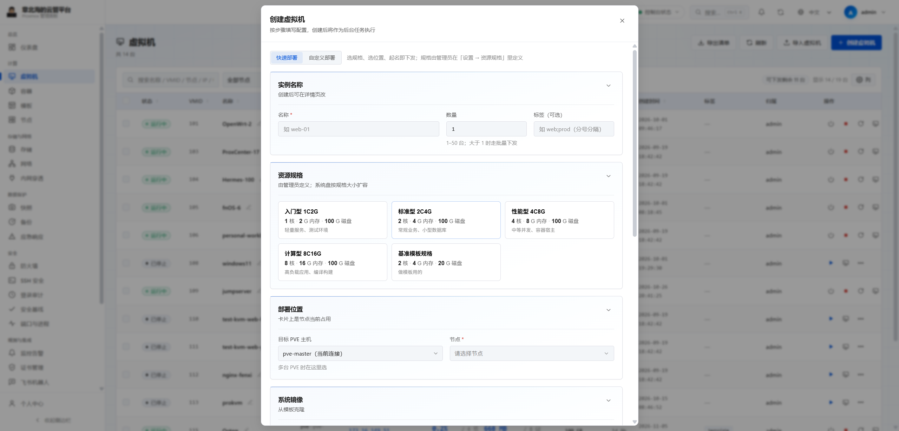

### LXC containers

Containers are a different set of PVE API endpoints, and a parallel set of pages in the panel. A
three-step wizard takes templates from storages whose content type includes `vztmpl` (when there is
none, it prints the `pveam download` command). Lifecycle, snapshots (without memory state), cloning
(full only — PVE has no linked clones for containers), migration, console; rootfs and mount point
resize, adding mount points, storage migration; adding and removing NICs, with the IP written into the
NIC config, effective after a restart.
<!-- screenshot: docs/screenshots/lxc-list.png -->

Resetting the root password inside a container goes through SSH → Managed hosts. Containers have no
Guest Agent and PVE has no “run a command inside the container” endpoint, so the panel runs
`pct exec` with that host's SSH credentials. When the host has no credentials configured the dialog
says so and suggests using the container console and `passwd` yourself.

### cloud-init template pipeline

Build a template from a cloud image in one action: the backend runs the steps in order and waits for
each task in between — create the VM (the system disk uses `import-from=<image>` so PVE imports it
directly, instead of the `importdisk` endpoint removed in PVE 9.2) → configure boot order and the
cloud-init drive → resize if needed → convert to a template. Any failure deletes the temporary VM, so
no half-built guest is left behind. Once built, “deploy from template” starts guests in batch and
injects hostname, SSH key and IP on clone.

<!-- screenshot: docs/screenshots/template-pipeline.png -->
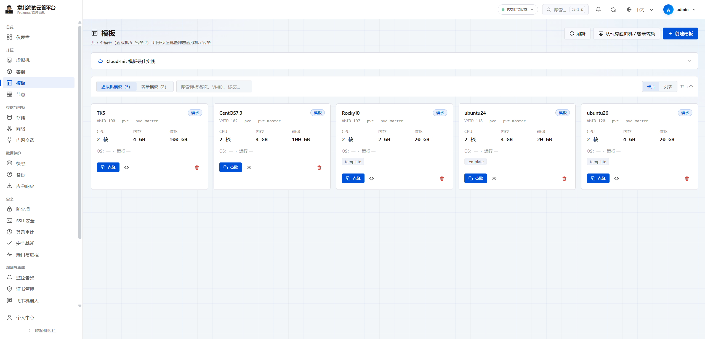

> **An image's extension must match its real format**: `.qcow2` / `.raw` / `.vmdk` / `.vdi` / `.vpc` /
> `.qed`. PVE only parses those suffixes and copies anything else verbatim as a raw disk — the classic
> case is Ubuntu's official `*-cloudimg-amd64.img`: it is really a qcow2 (3.5 GiB virtual, 248 MiB on
> disk), and copied as a raw disk its first sector is `QFI\xfb` instead of a boot signature, so the
> template builds fine and then stops at `Boot failed: not a bootable disk`. Uploads through the panel
> are detected by file magic and renamed (with a notice); files pushed in through the PVE UI or CLI
> cannot be intercepted, so rename them yourself or run
> `qemu-img convert -O raw <source> <target>.raw` first.
>
> The image can live on dir / NFS / CIFS or block storage: the source only has to be readable from that
> node, and the target storage must support `images`.
>
> You do not have to download by hand either: fill in “image download URL” in the wizard and the panel
> hands the URL to **PVE itself**, which downloads into the import directory of the chosen storage (the
> panel never relays the bytes, so a tens-of-gigabytes image neither fills memory nor blows up the
> reverse proxy), then selects it as the image source. The file name is corrected to a suffix PVE
> parses (`.img` → `.qcow2`).

### Networking and firewall (Bridge / Bond / VLAN)

Create, edit and delete node-level Linux bridges / bonds / VLANs. Changes go into “pending” first and
only take effect on “Apply configuration” — the same model as Proxmox itself, so a mistyped bridge
cannot cut the node off the network.

<!-- screenshot: docs/screenshots/firewall.png -->
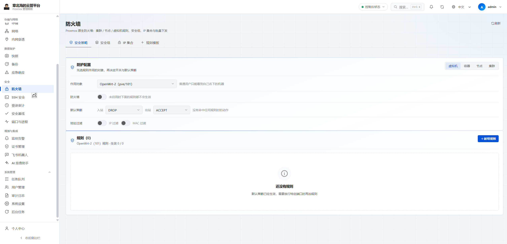

The firewall wraps the native Proxmox firewall instead of building another rule engine, so rules
configured in the panel are the same data the PVE UI and `pve-firewall` see. Three scopes (cluster /
node / guest, with qemu and lxc detected automatically); rules support in/out, ACCEPT / DROP / REJECT,
protocol, ports, source and destination (IP, CIDR, `+ipset`), PVE macros, interface binding, log level
and ordering. Security groups are cluster-level rule sets: reference one rule and the whole group
applies, edit the group and every reference changes. IP sets hold reusable address ranges; rule
templates can be pushed to many guests at once (replace or append) with per-target reporting, and warn
when a guest NIC does not have `firewall=1`, because the rules will not take effect. Permissions are
split into `firewall.view` / `firewall.manage` (own guests) / `firewall.cluster` (cluster-level and
security groups, admin only by default).

### SSH login security and fail2ban

Reads the SSH log of the host running the panel; logs of other hosts in the cluster are out of reach,
and the page states which host the data came from. The source falls back in three steps —
`/var/log/secure` → `/var/log/auth.log` → `journalctl -u ssh -u sshd` — counts only real
authentication failures, de-duplicates by sshd PID, and ignores health checks and port-scan noise.
Failed sources are aggregated by IP and can be banned in one click, marked trusted or added to an ignore
list; fail2ban jails, ban counts, unbanning and manual bans are all on the page, and custom policies are
written only to the panel's own `jail.d/panel-<jail>.local`, never to `jail.local`. Alerts use the
existing Feishu and mail channels: an IP crossing the failure threshold or an unfamiliar IP signing in
successfully raises a notice, and a recovery notice follows when the attack stops.

After filling in address, user and private key or password under “Managed hosts” (encrypted at rest
with `SECRET_KEY`), the same can be done on remote machines; the first connection asks you to confirm
the SSH fingerprint and later changes are refused outright. Permissions are `ssh.view` (visible to
everyone by default) and `ssh.manage` (ban, change policy — admin only by default).

<!-- screenshot: docs/screenshots/ssh-security.png -->
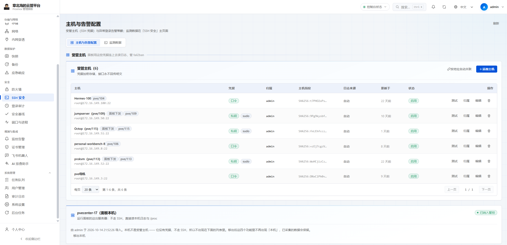

### Security baseline and port inspection

Both share one architecture. The target can be the local host (where the panel runs, reading system
files directly) or a managed host (reusing the SSH channel to run one read-only command remotely and
parse the output locally); local and remote share the same evaluation logic, so the conclusions are on
the same footing. The permissions are `baseline.view` / `baseline.manage` and `ports.view` /
`ports.manage`, the latter two admin-only by default.

<!-- screenshot: docs/screenshots/security-baseline.png -->
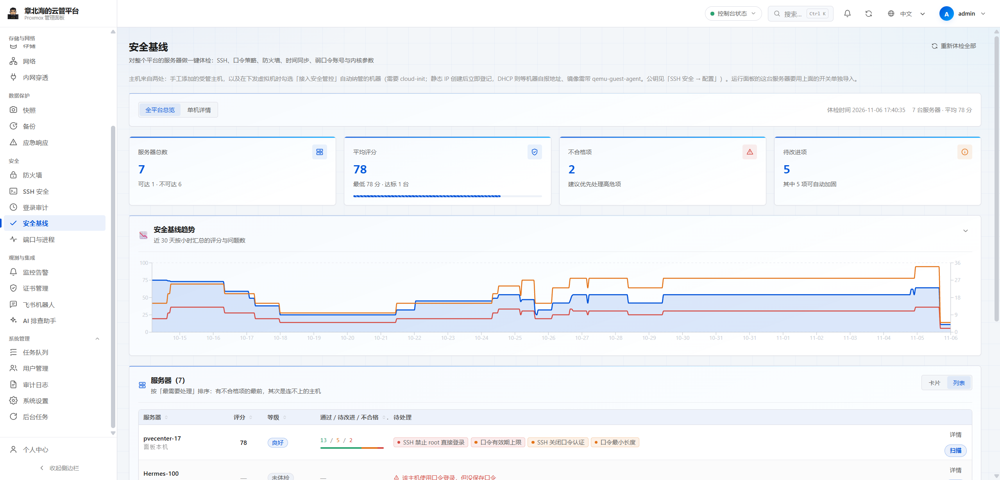

The baseline covers seven categories: SSH configuration, password policy, firewall, time sync, account
safety (empty passwords, UID 0) and key kernel parameters. The score is weighted by severity (high 3,
medium 2, low 1) into an A–D grade; items that cannot be checked are left out of the denominator, so
missing permissions never cause a false deduction. One-click hardening writes only files the panel
names itself, validates SSH with `sshd -t` immediately and re-reads `/proc` after sysctl changes,
rolling back automatically when validation fails. Items that could lock you out — such as disabling
SSH password authentication — are excluded from one-click hardening and must be confirmed one by one.

The port inspection uses `ss -tulpn` (`netstat` as a fallback on older systems) to list protocol,
listening address, owning process and exposure; listening on a non-loopback address counts as
“public”, and the firewall state collected in the same pass raises the risk level when no firewall is
active. Suspicious processes use reverse-shell heuristics: `/dev/tcp` redirects, `nc -e`, `socat exec:`,
sockets and `dup2` in scripts, `curl|sh` and so on, combined with context (a shell holding an outbound
connection, an executable in `/tmp`, a deleted executable, known miner process names). Policies accept
“expected ports” and a process allowlist regex to cut false positives.

> One thing to be clear about: the port inspection is a heuristic, not an antivirus engine. Every hit
> lists the rule it matched, and the panel never kills a process on that basis. “Public” only means it
> listens on a non-loopback address — whether it is actually reachable depends on the firewall and the
> upstream network, so the report includes the firewall state and leaves the call to you. To inspect a
> Proxmox node in the cluster, add it as a managed host; the PVE API has no “run a shell on the node”
> endpoint.

### Emergency response

- **Isolate a suspicious VM in one click**: snapshot for evidence → cut the network → power off → turn
  on VM protection. The order is deliberate: powering off first would destroy the scene. Each step runs
  and reports independently, so a failed snapshot does not stop the network cut but is flagged in red.
  The network cut sets `link_down=1` per NIC by editing that segment of the raw config string, leaving
  `bridge`, `tag` and `macaddr` untouched.
- **Backup delete protection**: register a backup volume as protected and set the `protected` flag on
  the PVE volume where possible; the panel's delete endpoint refuses to delete a protected backup. Even
  with an admin session, ransomware cannot delete it without first lifting protection in the UI. The
  registered backups are also compared with the actual PVE content periodically — a missing volume or
  changed metadata raises an alert.

> Boundaries: real immutability (WORM) can only be guaranteed by the storage side (PBS retention, S3
> Object Lock, read-only mounts); the PVE API alone cannot do it. A snapshot is a crash-consistent disk
> copy, not a memory image; `link_down` only cuts the PVE virtual NIC, so PCI passthrough / SR-IOV NICs
> are unaffected. PVE does not return checksums for storage content, so a backup fingerprint is a hash
> of `volid|size|ctime` — enough to catch deletions and replacements, not silent bit flips.

### AI operations assistant

It hands the findings the platform already has (security baseline / ports and processes / login audit /
alerts / change log / metric history) to a large model for attribution and answers “which one do I fix
first”. It is not a one-shot summary but a conversation you can follow up on: pick a managed host →
read platform data first, run read-only commands on the host when needed → answer as it goes →
conclusions become a report with `source_ref` on every item pointing back to the original check, so you
can verify them yourself.

<!-- screenshot: docs/screenshots/ai-assistant.png -->
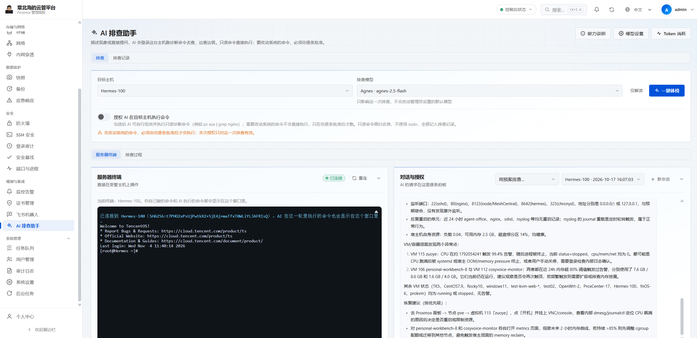

Read-only is the default tier. The tools are a finite set of parameterised command templates, with no
“run any command” catch-all; parameters are guarded by regex and path allowlists, and sudo is not used.
Only after ticking “authorise the AI to run commands on the target host” may the model compose
read-only pipelines itself (such as `ps aux | grep nginx`), and then the first executable of every
segment must be on the read-only allowlist, with `;`, `&&`, `||`, redirects and command substitution
rejected, plus a blacklist for things like `/etc/shadow`. Commands that change the system are always
shown first and executed only after you approve them one by one; `rm -rf /`, `mkfs`, `dd` and
power-off/reboot are blocked even when approved.

The remote terminal shares the same view: an interactive SSH terminal in the browser (xterm.js loaded
on demand), where your own commands and the AI's commands and output appear in the order they happened,
so there is no second window to check “what did the AI actually do on my machine”. Data visibility
follows permissions (ordinary users see alerts / backups / inspection results for their own guests, and
SSH login analysis needs `ssh.view`), and every run records model, step count, tokens and each tool
call under “Investigation records”, replayable and exportable as CSV (one row = one tool call). There is
also a token consumption view with 1 / 7 / 30 day totals, the input/output split and a per-model
breakdown.

It needs `ai.exec` (authorise command execution) and `ai.terminal` (open a remote terminal), both
admin-only by default. A terminal hands the host's login credentials to whoever uses it, and the
assistant's execution powers go far beyond any other page.

> One thing to be clear about: the model offers attribution suggestions, not conclusions. Every item
> carries a `source_ref` pointing at the original check — verify it yourself. The command allowlist and
> blacklist are generated live by the backend, so what “capability notes” shows is the same rule set
> enforced at execution time. Authorisation lasts for the current session only and resets when you
> switch hosts or start a new one; write-command approvals time out after 120 seconds and a timeout
> counts as a refusal.

### Monitoring and alerting

Total VM count and run distribution, CPU / memory / storage ring charts, a node overview, recent tasks
and the top 8 resource consumers; live node metrics come over `/ws/metrics` (pushed every 5 seconds,
reconnecting automatically and falling back to 10-second polling); disk capacity is extrapolated
linearly from the node root partition history to give a daily growth rate and estimated days until
full; nodes and guests each have RRD charts. Alert rules take a threshold and a duration, notifications
go out over mail and a Feishu bot, and both firing and recovery send one message.

<!-- screenshot: docs/screenshots/monitoring.png -->
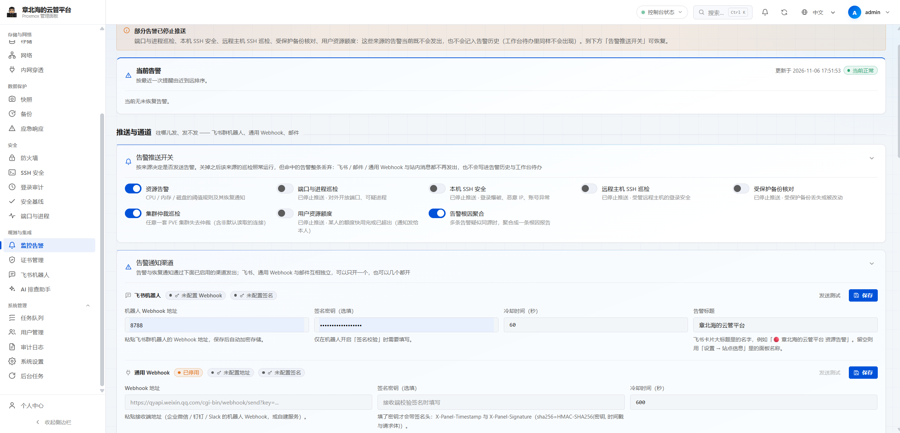

### Snapshots, backups and restore

Snapshot creation (optionally with memory state), rollback, deletion and a cross-guest view; back up
now (snapshot / suspend / stop modes), browse backup volumes, restore to a given VMID, delete; create
PVE scheduled backup jobs visually. Backup volumes can be registered as protected, and the panel's
delete endpoint refuses to remove them.

<!-- screenshot: docs/screenshots/backup.png -->
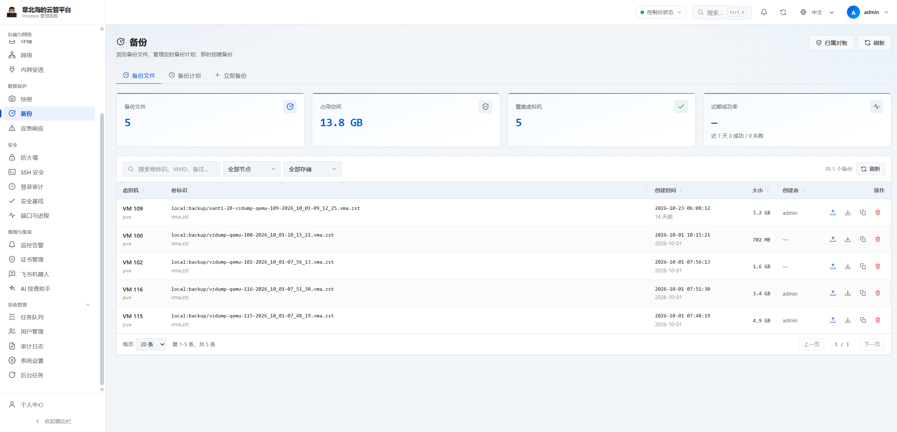

### VNC console

An in-browser noVNC graphical console with automatic reconnect, full screen and a Ctrl+Alt+Del button;
the backend relays the WebSocket in both directions, so the PVE web interface never has to be exposed to
the internet.

### Login audit and operation audit

Host login audit: `last` / `lastb` are parsed into account, terminal, source IP, time and status, plus
boot records and sudo / su escalation from auth.log. Events are pulled incrementally into `audit_log`
with one cursor per host, in the same table as the panel's own operations; the job runs every 5 minutes
and re-imports do not duplicate rows. Login logs inside a VM are unreachable, but the VM's IP can be
matched against each host's login records to answer “was this VM used to sign in to the host?”. If a
host exposed through frp should record the real source IP (rather than the entry machine's), see the
[frp real-IP guide](docs/frp-real-ip.md).

<!-- screenshot: docs/screenshots/audit-log.png -->
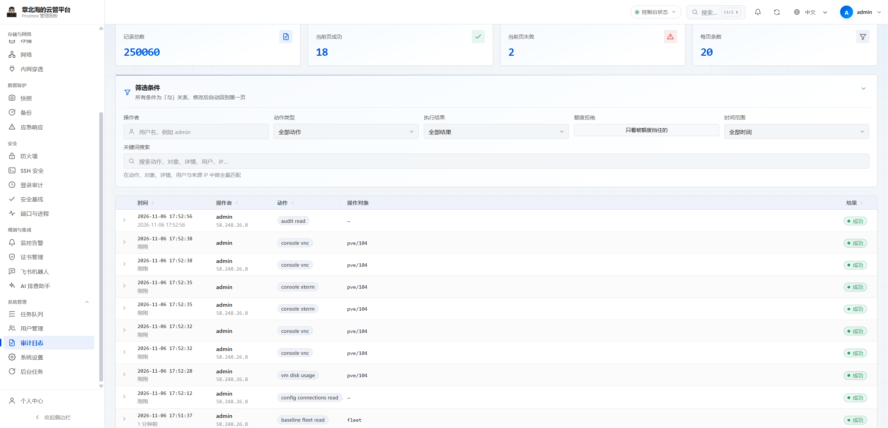

### Certificate management (ACME / multi-cloud / PVE nodes)

Talks to Tencent Cloud, Alibaba Cloud and Huawei Cloud free certificates, your own ACME account
(Let's Encrypt / ZeroSSL, with wildcard and multi-domain support) and manually uploaded managed
certificates. Renewal happens automatically before expiry and the result is deployed per site to a local
directory, a remote SSH server, a PVE virtual machine (Guest Agent), an LXC container, or the PVE node's
own 8006 management certificate; a reload command can follow the deployment, and on PVE nodes PVE
writes the file and restarts pveproxy itself. Multiple site bindings, a certificate inventory, expiry
monitoring and failure back-off are included.

<!-- screenshot: docs/screenshots/certificates.png -->
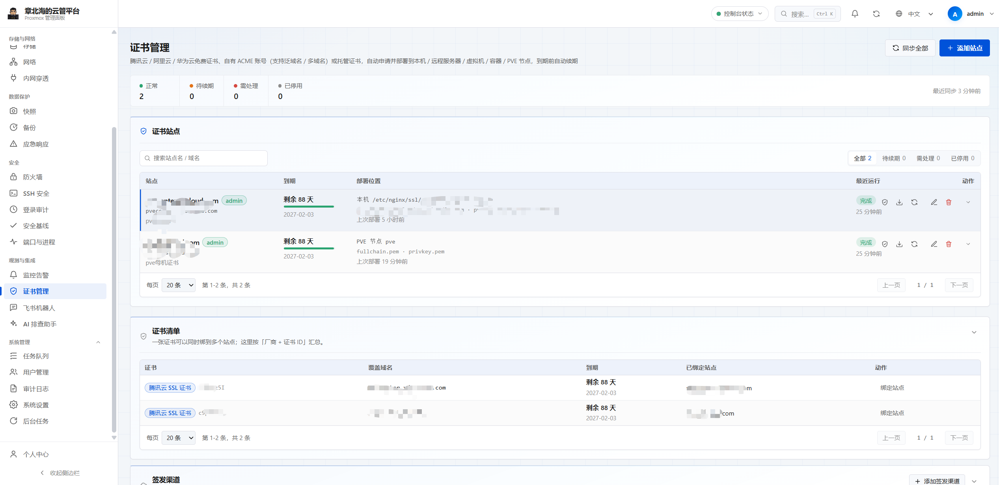

### Multi-user, RBAC and quota

| Role | What it can do |
|---|---|
| `admin` | Everything, including user management, connection settings, deleting VMs and cluster-level firewall |
| `operator` | Create / power / console / snapshot / backup / clone / reconfigure, manage the firewall of its own guests, view SSH statistics; cannot manage users, delete VMs or change cluster-level firewall |
| `viewer` | Read-only |

<!-- screenshot: docs/screenshots/users-rbac.png -->
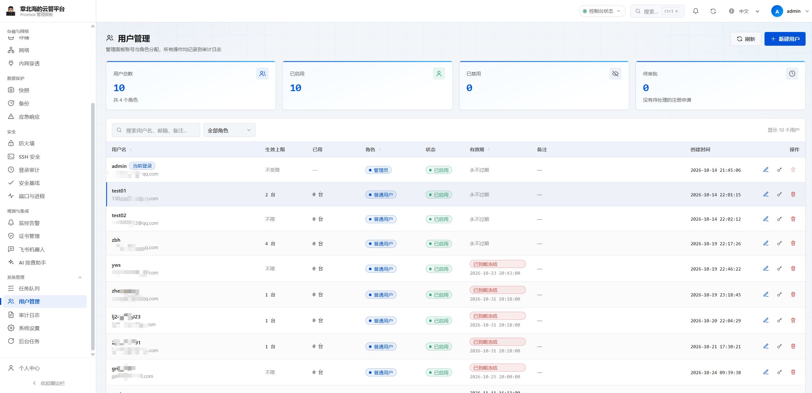

- Self-registration with admin approval: a new account stays `pending` and cannot sign in; approval
  assigns role and permissions in one step. Email is required and the result is mailed (mail is a side
  channel — a failed send is only audited).
- Every write operation (including failures) goes to the audit log with user, action, target, result,
  details and source IP, and can be filtered.
- Guard rails: the last administrator cannot be deleted, disabled or demoted, and the signed-in account
  cannot be deleted.
- The quota is a global VM count limit, not per user. Set the total under Settings → VM creation
  defaults → number of VMs that may be created; used = current total VM count (templates included).
  `0` means ordinary users cannot create any while administrators are unrestricted; empty means
  unlimited. Enforcement covers both `POST /api/vms` and
  `POST /api/vms/{node}/{vmid}/clone` — intercepting only the former would let repeated clones through.
  Ordinary users see usage for **their own** guests only (the same basis as “My quota”), while
  platform-wide used / limit is shown only to administrators and on the settings page — so “how many
  are left in the cluster” is never mistaken for “how many may I still create”, and cluster size is not
  disclosed.
- Connection settings can be changed online, are stored in MySQL and take effect on save without a
  restart; the token secret is never sent to the frontend in clear text. “Environment self-check” asks
  Proxmox for the token's effective permissions and lists API reachability, node visibility, storage,
  guests and console credentials item by item, turning each anomaly into a directly runnable fix
  command.

---

## 3. Configuration

`backend/.env` (Docker passes the same names as environment variables; the full sample is
`backend/.env.example`):

| Variable | Default | Notes |
|---|---|---|
| `SECRET_KEY` | placeholder | Required. Signs login JWTs and is the encryption root for stored ciphertext; at least 32 random characters. A placeholder or a short value refuses to start |
| `ADMIN_USERNAME` / `ADMIN_PASSWORD` | `admin` / empty | Administrator created on first start. At least 12 characters; empty or weak passwords refuse to start |
| `HOST` / `PORT` | `0.0.0.0` / `8080` | Bind address. All interfaces by default, so `IP:8080` works right after install; switch back to `127.0.0.1` when a reverse proxy sits in front, so 8080 is only open to the proxy |
| `FORCE_HTTPS` | `false` | Plain HTTP is always answered with a 308 redirect to https, HTTPS responses carry HSTS; only loopback is exempt |
| `FORWARDED_ALLOW_IPS` | `127.0.0.1` | Which sources may set `X-Forwarded-Proto` / `X-Forwarded-For`. Keep it at the proxy address; **never `*`** |
| `PANEL_ALLOW_CIDRS` | empty | Panel access allowlist (IP / CIDR, comma separated). Non-listed sources cannot reach the login page or any WebSocket; empty means no restriction |
| `LOGIN_IP_ALERT` | `true` | Notify administrators in-app and by mail on the first sign-in from a new IP |
| `API_DOCS_ENABLED` | `false` | Mount `/api/docs`, `/api/redoc`, `/api/openapi.json` (admin sign-in required); keep off in production |
| `LOGIN_MAX_FAILURES` / `LOGIN_LOCKOUT_MINUTES` | `5` / `15` | How many failures trigger a lockout, counted per account and per source IP |
| `ACCESS_TOKEN_EXPIRE_MINUTES` / `REFRESH_TOKEN_EXPIRE_DAYS` | `720` / `14` | Token lifetimes; the latter is how long one sign-in can last |
| `TOTP_REQUIRED_ROLES` | empty (`.env.example` shows `admin`) | Roles forced to set up two-factor authentication; `admin` means administrators must bind TOTP first |
| `TOTP_TRUST_ENABLED` | `true` | Whether the login page may offer “trust this device” (skip the code on the same browser for 7 days). `false` requires the second factor on every sign-in |
| `RATE_LIMIT_ENABLED` / `RATE_LIMIT_PER_MINUTE` / `RATE_LIMIT_AUTH_PER_MINUTE` | `true` / `300` / `30` | Rate-limit switch, per-IP per-minute limits for ordinary requests and for the sensitive endpoints (sign-in / registration / password reset / refresh / 2FA) |
| `STEP_UP_REQUIRED` / `STEP_UP_WINDOW_MINUTES` | `true` / `5` | Whether dangerous operations ask for confirmation again, and how long that confirmation stays valid |
| `FRP_ALLOW_LOCAL_CIDRS` / `FRP_BLOCK_PANEL_SUBNET` | empty / `true` | Tunnel target allowlist: ordinary users may only point at their own VM / container IPs, and networks can be opened here (or single IPs per user under “User grants” on the frp page); pointing at the panel's own subnet is blocked by default |
| `FRP_REMOTE_PORT_MIN` / `FRP_REMOTE_PORT_MAX` | `40000` / `50000` | Initial / fallback range of public ports for tunnel rules. Administrators can set it on the frp page to whatever range frps actually serves (applied immediately and stored in the database; the page wins). Critical ports such as 22 / 80 / 443 / 7000 / 7001 / 8006 are always refused |
| `PVE_HOST` / `PVE_PORT` | empty / `8006` | Proxmox address (without protocol) and API port |
| `PVE_TOKEN_ID` / `PVE_TOKEN_SECRET` | empty | The form is `panel@pve!panel` and the token UUID |
| `PVE_VERIFY_SSL` | `false` | Whether outbound connections verify the PVE certificate. Off by default: PVE is self-signed and verification fails at the handshake. For real security pin the certificate with “Certificate PEM” (`ca_cert`) in the connection, or set this to `true` when it comes from a public CA |
| `PVE_TRUST_ENV` | `false` | Whether requests honour `HTTP_PROXY` / `HTTPS_PROXY` from the environment |
| `PVE_CONSOLE_USER` / `PVE_CONSOLE_PASSWORD` | empty | PVE account and password for the console; the console is unavailable when empty |
| `CORS_ORIGINS` | `http://localhost:5173` | Allowed frontend origins, comma separated |
| `DB_HOST` / `DB_PORT` / `DB_USER` / `DB_PASSWORD` / `DB_NAME` | `127.0.0.1` / `3306` / empty | MySQL connection; the database name is required |
| `DB_POOL_SIZE` | `8` | Connection pool ceiling |

Only MySQL is supported; create the database first, the tables are created on startup:

```sql
CREATE DATABASE pvecenter_panel CHARACTER SET utf8mb4 COLLATE utf8mb4_unicode_ci;
```

Values in `.env` are initial defaults only; they can also be changed online under Settings, and the
online configuration wins. Mail (SMTP) has no environment variables at all — configure it under
Settings → Mail notifications. Its password is encrypted with `SECRET_KEY` before storage and the API
only ever returns `password_set`, never the clear text.

---

## 4. Project layout

```
pvecenter/
├── Dockerfile / docker-compose.yml / docker-entrypoint.sh   container packaging and deployment
├── deploy.sh                  bare-metal installer, idempotent, safe to re-run
├── start.sh / start-prod.sh   dev mode (with Vite) / production (backend serves dist/)
├── backend/
│   ├── run.py                 entry point
│   ├── .env.example           configuration sample
│   └── app/
│       ├── main.py            FastAPI app, route mounting, error handling
│       ├── pve.py             Proxmox API client (token + ticket auth)
│       ├── vmconfig.py        builds and parses VM / container configuration
│       ├── bulk.py            batch operation orchestration
│       ├── security.py        JWT sessions, RBAC permission model, audit helpers
│       ├── store.py           MySQL: users, audit log, connection settings
│       └── routers/           one module per page: vms / lxc / templates / console /
│                              tasks / network / baseline / portguard / isolation /
│                              backups / users / audit / config
└── src/
    ├── api/                   axios client, types, endpoint wrappers
    ├── hooks/                 auth, toast, task waiting, WebSocket
    ├── components/ · pages/   layout, shared UI components and pages
    ├── i18n/                  Chinese and English strings
    └── styles/                dark theme design system
```

---

## 5. Tests

```bash
cd backend
../.venv/bin/python -m pip install -r requirements-dev.txt
../.venv/bin/python -m pytest        # roughly 1000 cases
```

Three layers, none needing a real Proxmox environment: pure logic (configuration assembly, permission
matrices, field aliases, partial failures and ownership checks in batch operations); a simulated
Proxmox (a fake HTTP server to verify auth headers, response unwrapping, task polling and the mapping
from errors to status codes); and full API paths (TestClient from request to response, covering RBAC,
audit, the three firewall permission tiers, SSH log parsing and alerting, remote hosts, baseline
decisions, port heuristics and every guest password channel).

> API tests connect to a separate `<DB_NAME>_test` database and skip automatically when MySQL is
> unreachable or the account cannot create it, so the business database is never touched.

Frontend:

```bash
npm run typecheck     # tsc --noEmit
npm run build         # tsc -b && vite build
npm run verify        # all of the above, plus the i18n consistency check
```

To check the build output without Nginx, start the built-in static server (with `/api` and WebSocket
proxying): `npm run build && npm run serve:dist` (<http://localhost:8090>).

It talks to the PVE REST API, and 8.x and 9.x share the same code path with no per-version branches.
VM and container creation, start/stop and the console have been verified on PVE 8.4 and 9. The version
string is for display only, so upgrading Proxmox does not require changing code.

---

## 6. Troubleshooting

**You can sign in, but the VM and storage lists are empty.**
Open Settings → Environment self-check first. This is the most common API-token trap: a token created
in the Proxmox web UI has “privilege separation” ticked by default, so it starts with no permissions.
Privileged reads return 403, while endpoints like `/storage` return 200 with an empty array and it
looks like the panel is broken. The self-check asks PVE for the credential's effective permissions and
lists the exact commands to fix it:

```bash
pveum acl modify / --tokens 'root@pam!panel' --roles PVEVMAdmin
pveum acl modify / --tokens 'root@pam!panel' --roles PVEDatastoreUser
pveum acl modify / --tokens 'root@pam!panel' --roles PVEAuditor   # node metrics need Sys.Audit
```

The tell-tale sign: `privsep` is 1 in `pveum token list` and `/access/permissions` returns empty.

**The connection fails with 502 although Proxmox answers pings.** Check whether the machine running
the panel has `HTTP_PROXY` / `HTTPS_PROXY` set — the panel does not inherit them by default. If it
really must go through a proxy, set `PVE_TRUST_ENV=true`; otherwise add the Proxmox address to
`NO_PROXY`.

**The configuration looks right but the cluster is unreachable.** Connection settings resolve as
“database > `.env`”, so an address saved earlier wins over the new `.env` value. Change it under
Settings, or delete the `pve_connection` row from the `settings` table and restart. An unreachable
Proxmox does not stop the panel from starting; it only logs a warning, which is exactly what gives you
a chance to get in and fix it.

**The console does not open**: a Proxmox design limit — an API token cannot access `vncproxy`, so add a
PVE account and password under Settings (ideally `PVEVMUser` only). **It connects but stays black**:
templates built by the panel attach only `serial0` and deliberately do **not** point `vga` at it —
pointing it there leaves nothing but serial output in VNC, and an image without `console=ttyS0` goes
black right after GRUB. To see serial logs, switch the console to xterm; do not change `vga`.

**The template was built, but clones stop at `Boot failed: not a bootable disk`**: the image extension
does not match its real format. Ubuntu's official `*-cloudimg-amd64.img` is really a qcow2; PVE does not
recognise the suffix and copies the container verbatim as the system disk, so sector 0 is not a boot
sector. Check with `qemu-img info <image>`, then convert it to raw (`qemu-img convert -O raw`) or rename
it to `.qcow2` and rebuild the template. To inspect the disk itself:

```bash
qemu-img info <volume path>   # the virtual size should be the image's virtual size (3.5G for Ubuntu cloud images), not the file bytes
qemu-img dd -f qcow2 if=<volume path> bs=512 count=1 of=/tmp/mbr.bin && hexdump -C /tmp/mbr.bin | tail -2
```

The last two bytes should be `55 aa` (`eb 63 90` at the start is GRUB's MBR); `51 46 49 fb` means the
whole qcow2 container was written to the disk verbatim.

**Docker: the container will not start or keeps restarting.** Almost always a database password
mismatch. Run `docker compose logs panel | tail -30` and look for `Access denied` / `Can't connect`; the
fix is in the two notes under [Docker deployment](#docker-deployment).

**The panel runs on Python 3.9 / 3.10 and some features misbehave (typically: alert mails never arrive,
updates fail).** The dependency set is pinned to Python 3.11+, and the hardest floor is Pillow 12
(≥3.10) — on 3.9 `pip install -r backend/requirements.txt` fails to resolve, dependencies stay old and
the built-in updater stops at the install step. Current `start-prod.sh` / `run.py` refuse an old
interpreter outright and print the install commands; `/api/version` shows the interpreter actually in
use. Install 3.11+, then `rm -rf .venv` and start again (database and configuration are untouched).

**The host security pages read nothing**: inside a container, `/var/log` and `/proc` belong to the
container rather than the host. The page says so; mount them read-only as the comments in
`docker-compose.yml` describe when you want the data.

---

## 7. Security notes

Keys and passwords. A placeholder `SECRET_KEY` or one shorter than 32 characters refuses to start; an
empty `ADMIN_PASSWORD`, one under 12 characters or a weak one such as `admin123` is rejected as well.
The backend enforces both — do not cut corners.

HTTPS is mandatory in practice. Login credentials and API tokens travel in clear text over HTTP. Set
`FORCE_HTTPS=true` and terminate TLS on 443 with Nginx / Caddy. The proxy must send
`X-Forwarded-Proto`, and `FORWARDED_ALLOW_IPS` must list the proxy address only, otherwise a public
request can claim to be https and skip the redirect. Close the gap between the panel and PVE as well —
pin the certificate with the connection's “Certificate PEM” (`ca_cert`) or set `PVE_VERIFY_SSL=true` —
so the token cannot be intercepted between the two. In addition, `--privsep 1` with precise ACLs keeps
the panel to the resources it actually needs, and PVE's port 8006 never has to be exposed: all traffic
goes through the panel backend.

Secret configuration never comes back to the frontend. `GET /api/config/connection` returns only
`token_secret_set`, and leaving that field empty on update keeps the existing value; the SMTP password
only reports `password_set` as well. Administrators cannot read other users' webhooks or cloud keys
either.

Sign-in protection has three layers. The human check runs before the password is verified (so a script
cannot read “was the password right?”), and a failed captcha does not count towards the failure limit —
otherwise submitting a wrong image repeatedly could lock any account. Passwords themselves are counted
per account and per source IP, locked for several minutes after repeated failures, and the counters live
in MySQL so a restart does not clear them. Beyond that sits a global rate limit per source IP over
`/api/*`, with a tighter line for sensitive endpoints, answering 429 when exceeded. The limiter only
trusts `X-Forwarded-For` from a configured proxy, so a forged header on the client side gets nowhere.

Sessions are revocable and writes go through CSRF. Sign-in issues an access and a refresh token; the
refresh token lives in an `HttpOnly` cookie that JavaScript cannot read and XSS cannot steal. Logging out
revokes the server-side session and invalidates the current token immediately; “Profile → Login devices”
lets you kick devices one by one, and “sign out everywhere” or an administrator kick invalidates every
token ever issued to that account, as does a password change. Write requests must carry
`X-CSRF-Token` (from the deliberately readable `panel_csrf` cookie), which a cross-site page can neither
read nor forge; the WebSocket handshake authenticates by cookie and checks `Origin`, so tokens no longer
appear in URLs.

Two-factor authentication and step-up. `TOTP_REQUIRED_ROLES=admin` means administrators must bind an
authenticator before using the panel; binding hands out eight recovery codes once, and the secret is
encrypted with `SECRET_KEY` before storage. Deleting a VM, changing connection credentials, adding or
removing accounts, editing cluster-level firewall policy, pushing rules in batch and writing fail2ban
policies all require more than a valid token: the backend answers `403 + X-Step-Up: required` and asks
for the password again (plus a TOTP code when 2FA is on). Sensitive reads are audited too — viewing the
connection settings, the mail settings or the audit log itself each leaves a record. “Who copied the
cluster token” can only be answered from traces of reads.

---

## 8. Roadmap

What comes next, ordered by importance rather than by schedule:

- SDN networking. The “Networking” page currently manages node-level bridge / bond / VLAN; PVE 8.x / 9.x
  SDN (zone / vnet / subnet / controller / IPAM) has no entry point yet. It is a cluster-level object
  where one configuration applies to the whole cluster, so the baseline is: reads always available,
  writes always behind a diff preview and a confirmation, and no “rebuild the whole SDN” style
  non-rollbackable action.
- Billing and usage. Metric history is already being stored; what is missing is “by whom, how much,
  worth what”. The easiest thing to get wrong is the basis: PVE's network counters are cumulative and
  reset on reboot, migration or driver reset, so samples must be differenced and counter rollbacks
  dropped — otherwise the report shows negative or exploding traffic.
- Other candidates: multi-tenancy and resource pools, report subscriptions, verifiable backups (PBS),
  more alert channels (WeCom / DingTalk / Telegram / generic webhook), Prometheus metrics export, audit
  forwarding to a SIEM, LDAP / OIDC single sign-on, a light theme and a PWA.

The rationale and acceptance criteria for each item live in issues.

---

## Contributing

[Issues](https://github.com/yjscloud/pvecenter/issues), forks and pull requests are welcome. Before
submitting, run `npm run verify` and the backend `pytest`; feature requests are easier to prioritise
with the use case attached.

If the project helps you, a star is the most direct support.

---

## License

Released under the [Apache-2.0](LICENSE) license.
