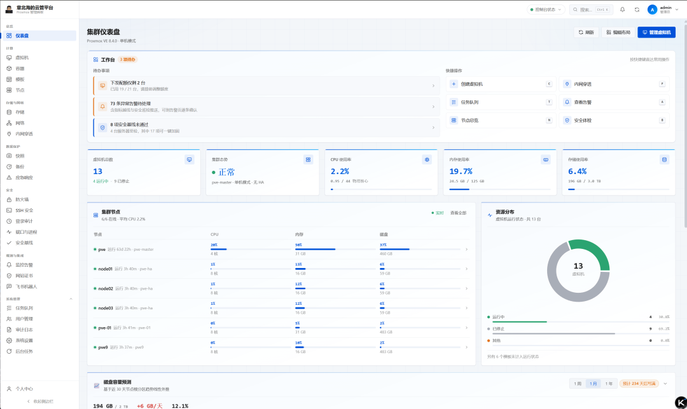

# ProxCenter — Web Management Panel for Proxmox VE 8.x / 9.x

**English | [简体中文](README.md)**

[](LICENSE) [](../../releases) [](https://github.com/yjscloud/ProxCenter/actions/workflows/ci.yml) [](../../stargazers)  

A self-hosted web panel for Proxmox VE 8.x / 9.x. It manages QEMU virtual machines and LXC
containers end to end: a cloud-init template pipeline, networking and firewall, monitoring
dashboards, snapshots and backups, an in-browser VNC console, multi-user RBAC with an audit log,
plus a few security operations features (SSH brute-force protection, port and process anomaly
detection, security baseline hardening).

One command does it all. It installs a systemd unit, so the panel comes back after a reboot:

```bash
git clone https://github.com/yjscloud/ProxCenter.git
cd ProxCenter
sudo ./deploy.sh
```

The last screen prints the panel URL and the initial password, which is shown only once. Prefer
containers? See [Docker deployment](#4-docker). Both ways are under [Deployment](#deployment).

> Keywords: Proxmox VE panel · Proxmox web panel · PVE management UI · LXC manager ·
> cloud-init templates · self-hosted virtualization console · Proxmox alternative UI

Stack: Python 3.11+ / FastAPI / httpx, React 18 + TypeScript + Vite, MySQL 8.

Live demo: <https://prox.yjscloud.com>



> [README.md](README.md) (Chinese) is the primary document. This page mirrors it in a condensed
> form.

## Contents

- [Deployment](#deployment): [API token](#1-create-a-proxmox-api-token) ·
  [permissions](#2-grant-permissions) · [bare metal](#3-bare-metal-deployment-recommended) ·
  [Docker](#4-docker) · [HTTPS](#5-put-it-behind-https) ·
  [service management](#6-service-management)
- [Features](#features) · [Configuration](#configuration) · [Project layout](#project-layout) ·
  [Tests](#tests) · [Troubleshooting](#troubleshooting) · [Security notes](#security-notes) ·
  [Compatibility](#proxmox-ve-compatibility) · [License](#license)

---

## Deployment

### 1. Create a Proxmox API token

The panel talks to Proxmox with an API token. Run this on a PVE node:

```bash
pveum user add panel@pve --comment "ProxCenter panel"
pveum user token add panel@pve panel --privsep 0
```

`--privsep 0` means the token inherits the user's permissions. The output gives `full-tokenid`
(for example `panel@pve!panel`) and the token secret. Put those into the panel as Token ID and
Token Secret.

### 2. Grant permissions

```bash
pveum acl modify / --user panel@pve --roles PVEVMAdmin,PVEDatastoreUser,PVESDNUser,PVEAuditor,PVEVMUser
```

Or split them for least privilege:

| Capability | Role |
|---|---|
| Read-only monitoring | `PVEAuditor` |
| Power on / off, console | `PVEVMUser` |
| Create / delete / reconfigure / snapshot | `PVEVMAdmin` |
| Backups, ISO and template storage | `PVEDatastoreUser` (`PVEDatastoreAdmin` to write) |
| Bridges and VLANs | `PVESDNUser` |

> Proxmox does not let an API token open a VNC console. That endpoint only accepts a ticket derived
> from a user password, so using the console in the browser means filling in a PVE user name and
> password under Settings as well. Without it the console is unavailable; everything else keeps
> working.

### 3. Bare-metal deployment (recommended)

It installs a systemd unit, so the panel comes back after a reboot and restarts if the process dies,
and `systemctl restart` is all it takes after a code change. The panel and the database run on the
host itself, which is what you want for a long-lived installation.

```bash
git clone https://github.com/yjscloud/ProxCenter.git
cd ProxCenter
sudo ./deploy.sh
```

The script installs the Python dependencies, builds the frontend, creates the database and installs
a systemd unit, without asking anything. Port `8080`, database `proxcenter_panel`, user
`proxcenter`; `SECRET_KEY` and the admin password are generated randomly and the last screen prints
the panel URL and the initial password, which is shown only once. Re-running it will not damage an
existing installation. Pass your own values if you want; it still will not ask:

```bash
sudo ./deploy.sh --port 9000 --mysql-root-password '<root password>' \
                 --db-name proxcenter_panel --db-user proxcenter --db-password '<db password>'
```

Useful flags: `--port` · `--service` (systemd unit name) · `--user` (default `root`) ·
`--skip-frontend` (reuse an existing `dist/`, no Node needed) · `--no-systemd` (prepare only, no
root) · `--reconfigure` (ask for each value) · `--help`.

> `SECRET_KEY` must not change after it is generated, because every stored PVE token and SMTP
> password was encrypted with it. That is why the script only overwrites keys you pass explicitly
> when `.env` already exists.

To watch the logs in the foreground instead of installing a service:
`npm run build && ./start-prod.sh`. When `dist/` exists, FastAPI serves both the frontend and `/api`
on port 8080, so the two are same-origin and the console's WebSocket works without an extra proxy.

### 4. Docker

Prefer not to install Python, Node or MySQL on the host? Run it in a container; the host only needs
Docker:

```bash
curl -fsSLO https://raw.githubusercontent.com/yjscloud/ProxCenter/main/docker-compose.yml
docker compose up -d
```

Open `http://<server-ip>:8080` and sign in as `admin` / `ProxCenter@2026`. Change that password.

All three passwords live in `docker-compose.yml`, search for `★ 改这里`. The lines look like this:

```yaml
ADMIN_PASSWORD: ${ADMIN_PASSWORD:-ProxCenter@2026}
```

`:-` is compose's "use this default" marker: *"if `.env` or the environment provides
`ADMIN_PASSWORD`, use that; otherwise use what follows"*. The `-`, `$`, `{` and `}` are syntax
only. The actual password is the `ProxCenter@2026` part, so change only the segment between `:-`
and the closing `}`:

```yaml
ADMIN_PASSWORD: ${ADMIN_PASSWORD:-MyPassw0rd2026}
```

The three are `ADMIN_PASSWORD` (panel login), `DB_PASSWORD` (database) and `MYSQL_ROOT_PASSWORD`
(MySQL administrator). Or leave the file alone and put a `.env` next to it with the password itself
after the equals sign; `.env` wins over the defaults.

Two things worth knowing up front:

- Passwords only take effect on first initialisation. `ADMIN_PASSWORD` is used only while the
  database has no administrator yet, and MySQL reads `MYSQL_PASSWORD` only when its data directory
  is empty. Changing them later means either `docker compose down -v` (which wipes the data) or an
  `ALTER USER` by hand; the commands are at the bottom of `docker-compose.yml`. To change your login
  password afterwards, use Profile → Change password.
- Leave `SECRET_KEY` alone. It signs login JWTs and is also the encryption root for the secrets in
  the database (PVE tokens, SMTP password). A value committed to a public repository would be a
  published key, so the container generates one on first start and keeps it in the `panel_data`
  volume. Changing it after you have data makes every stored secret undecryptable.

Images are built for amd64 (Proxmox VE itself is x86_64-only) and pulled from GHCR by default. To
use Docker Hub instead:
`PROXCENTER_IMAGE=docker.io/yjscloud/proxcenter:latest docker compose up -d`. Upgrading is
`docker compose pull && docker compose up -d`.

### 5. Put it behind HTTPS

The panel does not speak TLS itself. Terminate it on 443 in Nginx or Caddy and proxy to 8080,
including the WebSocket, or the console will not connect:

```nginx
server {
    listen 443 ssl http2;
    server_name panel.example.com;
    ssl_certificate     /etc/letsencrypt/live/panel.example.com/fullchain.pem;
    ssl_certificate_key /etc/letsencrypt/live/panel.example.com/privkey.pem;
    # Security headers (HSTS / CSP / nosniff / Referrer-Policy / Permissions-Policy)
    # are emitted by the panel itself — do **not** add them again here, duplicate
    # headers are simply invalid.
    server_tokens off;          # answer "Server: nginx" without the version

    location / {
        proxy_pass http://127.0.0.1:8080;
        proxy_http_version 1.1;
        proxy_set_header Upgrade $http_upgrade;        # needed by the console
        proxy_set_header Connection "upgrade";
        proxy_set_header Host $host;
        proxy_set_header X-Real-IP $remote_addr;
        proxy_set_header X-Forwarded-For $proxy_add_x_forwarded_for;
        proxy_set_header X-Forwarded-Proto $scheme;    # tells the panel the outside is https
        proxy_read_timeout 3600s;                      # the console is long-lived
        proxy_buffering off;
    }
}
```

Turn on forced HTTPS on the panel side too, otherwise hitting 8080 directly is still plain HTTP:

```
FORCE_HTTPS=true
FORWARDED_ALLOW_IPS=127.0.0.1
```

Keep `FORWARDED_ALLOW_IPS` at your proxy's address. Widening it lets anyone claim
`X-Forwarded-Proto: https` and bypass the redirect. With Docker, put both into the `.env` next to
`docker-compose.yml` (or straight into its `environment:` block).

### Public exposure hardening (strongly recommended)

The panel is a full-control entry point to PVE: one compromised panel account means the whole
virtualization platform is compromised. Exposing it to the internet is a supported deployment, but
it must be defended like any other internet-facing admin asset.

**None of the switches below are in the UI** — they live in a config file; which file depends on how
you deployed:

| Deployment | File to edit | Notes |
|---|---|---|
| Source / bare metal (`deploy.sh`, systemd) | `<install dir>/backend/.env` | Created by `deploy.sh` (template `backend/.env.example`). On this host that is `/data/proxcenter/backend/.env`; `deploy.sh --reconfigure` writes back to the same file |
| Docker Compose | the `.env` next to `docker-compose.yml` | Compose reads it via `${VAR:-default}`; editing the compose `environment:` block works too |
| Backend only (`start-prod.sh` / your own unit) | whatever `backend/.env` the process loads | `systemctl cat proxcenter` shows `EnvironmentFile=` / `WorkingDirectory=` |

Restart to apply: `systemctl restart proxcenter`, or `docker compose up -d` for Docker. The same
paths are stated in the “Security posture” notes on the Settings page.

1. **Prefer a private entrance**: put the panel behind a VPN / zero-trust gateway, or allow only
   fixed office / jump-host networks. For frp, restrict sources on the frp server or enable mTLS at
   the reverse proxy.
2. **Source allowlist**: `PANEL_ALLOW_CIDRS` makes the panel reject non-listed sources at the
   outermost layer (HTTP and VNC WebSockets), so even the login page and
   `/api/openapi.json` are invisible. When behind a proxy, set `FORWARDED_ALLOW_IPS` to the
   proxy's real address, otherwise the allowlist sees the proxy IP. Nginx can enforce the same:
   `allow 203.0.113.0/24; deny all;` (restore real client IPs with `set_real_ip_from` if a CDN
   sits in front).
3. **Require 2FA for admins**: `TOTP_REQUIRED_ROLES=admin`. Keep the built-in login lockout and
   captcha enabled — the same human check also guards **self-service registration**, otherwise
   scripts can flood the approval queue.
4. **New-IP sign-in alerts**: enabled by default (`LOGIN_IP_ALERT=true`). The first successful
   sign-in of an account from a new IP notifies all admins in-app, plus email when SMTP is set up.
   The event is recorded as `auth.new_ip` in the audit log.
5. **Do not expose port 8080 directly**: with Docker, set `PANEL_BIND=127.0.0.1`; never use
   `FORWARDED_ALLOW_IPS=*` (clients can forge their source IP, breaking the allowlist, login
   lockout and audit IPs).
6. **Review the logs**: `/api/audit` and `/api/host-audit` are admin-only by default.
7. **API docs are off by default**: `/api/docs`, `/api/redoc` and `/api/openapi.json` all return
   404. The full OpenAPI spec enumerates every endpoint, field constraint and hidden route — a
   complete attack map. For troubleshooting, set `API_DOCS_ENABLED=true` temporarily; even then
   those routes require a signed-in user with `settings.manage`, and anonymous callers get 401.
8. **`/api/health` only says "alive" to anonymous callers**: signed-out requests get
   `{"status":"ok"}` — no Proxmox version, node count or connection state (a version string is
   directly matchable against public CVE lists). Signed-in callers still get the full reading;
   deep diagnostics live at `/api/config/diagnostics` (admin).
9. **Security headers come from the panel**: CSP (`script-src 'self'` for normal pages),
   `X-Content-Type-Options: nosniff`, `Referrer-Policy: strict-origin-when-cross-origin`,
   `Permissions-Policy`, `frame-ancestors 'none'`, `X-Frame-Options: DENY` and HSTS are all
   emitted by the app (`SecurityHeadersMiddleware` in `backend/app/main.py`). The reverse proxy
   should only terminate TLS — **do not add the same headers again**; two HSTS lines are invalid.
10. **TLS verification to Proxmox is off by default**: new connections start with `verify_ssl: false`
   (`PVE_VERIFY_SSL=false`). PVE ships a self-signed certificate (cluster CA, `CN=pve.local`, no IP
   SAN), so verifying against the system trust store fails at the handshake — which reads like a
   wrong address or token when you are wiring up a fresh install.
   To verify, use pinning rather than just flipping the switch: paste the PVE certificate PEM into the
   connection's **Certificate PEM** field (`ca_cert`: only that certificate is trusted, refresh it
   after rotation). Pinning is stricter than the system store and independent of the switch. Fetch it
   with `openssl s_client -connect <PVE-IP>:8006 </dev/null 2>/dev/null | openssl x509` or read
   `/etc/pve/pve-root-ca.pem` on any node. Turn the switch on when the certificate is issued by a
   public CA or already pinned. A connection running unverified is reported in the log.
11. **Put the backend back on loopback once a reverse proxy is in front**: with `HOST=127.0.0.1`,
    8080 is not exposed to the LAN and every request goes through nginx (a fresh install binds
    `0.0.0.0` so `IP:8080` works out of the box). Set `client_header_timeout` / `client_body_timeout` /
    `send_timeout` and `limit_conn` on the proxy (the nginx example above carries the first three)
    so slow connections cannot exhaust workers.
12. **API tokens are capped at 365 days** and can no longer be created without an expiry: tokens run
    unattended, so expiry is the backstop after a leak. Re-issue before it lapses — the list shows
    the remaining days.
13. **Do not advertise component versions**: the app sends neither `Server` nor `X-Powered-By`
    (`server_header=False` in `run.py`, plus the security-header middleware), and nginx should run
    `server_tokens off;` so it answers `Server: nginx`. FAQ text and UI examples no longer mention
    internal sample addresses, ports or renewal mechanics.
14. **No sourcemaps in production**: `build.sourcemap=false` in `vite.config.ts` — a `.map` carries
    `sourcesContent`, i.e. the complete TypeScript source (API wrappers, request fields, error
    branches). nginx also answers 404 for `*.map` as a second line of defence; use `npm run dev`
    when you need debugging symbols.
15. **Version and RBAC listings require a session**: `/api/version` and
    `/api/auth/permissions` now depend on `get_current_user`; only `/api/config/site`
    (site name, logo, ICP) stays anonymous so the login page and landing page can render.

For mTLS, add `ssl_client_certificate /etc/nginx/client-ca.crt;` and `ssl_verify_client on;`
to the Nginx server block.

### 6. Service management

`./deploy.sh` installs a systemd unit, so the panel comes back after a reboot and restarts if the
process dies:

| Action | Command |
|---|---|
| Status / start / stop / restart | `systemctl status\|start\|stop\|restart proxcenter` |
| Enable at boot | `systemctl enable proxcenter` |
| Follow the logs | `journalctl -u proxcenter -f` |

A frontend-only code change just needs `npm run build`; a backend change needs
`systemctl restart proxcenter`. Confirm it came up with
`curl http://127.0.0.1:8080/api/health`.

> With Docker this section does not apply; the container already carries `restart: unless-stopped`.

### 7. Upgrading

The panel checks for new versions itself: Settings → System information → Panel version and update
shows the current and latest version plus *Check for updates* and *Update now*, and a banner appears
in the top bar when a new release exists (only for accounts holding `settings.manage`). It asks
GitHub Releases once a day by default; that can be turned off in the same place, and the interval
changed under *Background jobs*.

Updating in the panel does exactly what the manual route does: fetch the new tag, then run
`./deploy.sh` (install dependencies + build the frontend + restart the service). It is therefore
only offered when it can actually work: the install directory is a git checkout, the process is
managed by systemd, the user is root, Node.js 22.22+ is installed (without it the frontend cannot be
rebuilt, and replacing only the backend would leave UI and API out of sync), and the work tree has
no uncommitted changes. Whenever one of those fails, the panel explains why and shows these
commands instead:

```bash
cd /data/proxcenter
sudo git fetch --tags --prune origin
sudo git checkout v0.1.5      # the tag shown as the latest version in the panel
sudo ./deploy.sh              # idempotent: safe to re-run
```

On a host without Node.js, build on a machine that has it, copy `dist/` back and run
`sudo ./deploy.sh --skip-frontend`.

> An instance started by hand (`python backend/run.py`) is not managed by systemd, so one-click
> updating is refused: the script restarts the service, which is a different process, and the new
> code would never run. Stop the manual instance first, or use the commands above.

---

## Features

- Virtual machines: four-step creation wizard (blank, clone a template, or import a cloud image),
  power operations with graceful shutdown and force-stop fallback, online reconfiguration, disk
  resize and migration, batch operations that execute per target and let you retry only the
  failures, and guest password resets through the QEMU guest agent or cloud-init.
- LXC containers: their own pages (PVE uses different endpoints), three-step wizard, rootfs and
  mount point management, snapshots, full-only clones, migration, and root password resets over SSH
  via `pct exec` on the host.
- cloud-init template pipeline: one action builds a template from a cloud image, waiting for each
  task between steps, and deletes the temporary VM on failure. Images must live on dir / NFS / CIFS
  storage.
- Networking and firewall: node-level bridges, bonds and VLANs with changes pending until you apply
  them, plus a wrapper around Proxmox's native firewall covering three scopes, in/out rules with
  protocols, ports, sources and destinations, PVE macros and ordering, security groups, IP sets and
  rule templates pushed to many guests at once.
- SSH login security: reads the panel host's SSH log (three-way source fallback, de-duplicated by
  sshd PID so scans raise no alarm), aggregates failed sources by IP for one-click banning, manages
  fail2ban jails and custom policies, and sends alerts with a recovery notice when an attack stops.
  Managed hosts extend all of it to other machines.
- Security baseline and port scan: the same evaluation runs on the panel host and managed hosts,
  scoring SSH configuration, password policy, firewall, time sync, account safety and kernel
  parameters, with one-click hardening that validates itself (`sshd -t`, `/proc` re-read) and rolls
  back on failure. The port scan lists listeners and flags reverse-shell shapes. It is a heuristic,
  it never kills anything, and it says which rule matched.
- Emergency response: isolating a suspicious VM snapshots it first, then drops the network, powers
  it off and enables protection. Backups can be registered as protected so the panel refuses to
  delete them.
- AI inspection assistant: hands the platform's existing findings (baseline, port scan, login audit,
  alerts, change log, metrics) to a model that answers "what to fix first", as a conversation you
  can follow up on rather than a one-shot summary. Read-only by default (parameterised templates,
  regex and path allow-lists, no sudo). With "authorise the AI to run commands" ticked it may compose
  read-only pipelines such as `ps aux | grep nginx`, with every executable allow-listed and `;`, `&&`,
  `||`, redirects and command substitution rejected. Anything that changes the system is shown first
  and approved command by command, and `rm -rf /`, `mkfs`, `dd` and power operations are refused even
  if approved. A built-in SSH terminal shares the view, conclusions carry a `source_ref` back to the
  original check, and every tool call plus token usage is recorded and exportable as CSV. Needs
  `ai.exec` and `ai.terminal` (admin-only by default).
- Audit and monitoring: `last` / `lastb` and sudo / su entries folded into the same audit table as
  the panel's operations, cluster dashboards, live node metrics over `/ws/metrics`, RRD charts, disk
  capacity forecasting, and Feishu webhook plus mail notifications with per-user channels.
- Snapshots, backups and console: snapshot and backup management including scheduled `vzdump` jobs,
  and an in-browser noVNC console (the backend proxies the WebSocket, so PVE never has to be
  exposed).
- Users, quota and audit: three built-in roles (`admin`, `operator`, `viewer`), self-registration
  with admin approval, every write logged with user, action, target, result, details and source IP,
  and one global VM count limit covering both creation and clone.

---

## Configuration

Everything lives in `backend/.env` (Docker takes the same names as environment variables; see
`backend/.env.example`). Values can also be changed at runtime under Settings, which wins. The ones
that matter:

| Variable | Default | Notes |
|---|---|---|
| `SECRET_KEY` | placeholder | Required. Signs login JWTs and encrypts stored secrets. A placeholder or fewer than 32 characters refuses to start |
| `ADMIN_USERNAME` / `ADMIN_PASSWORD` | `admin` / empty | First account. A password under 12 characters, empty or a common one refuses to start |
| `HOST` / `PORT` | `0.0.0.0` / `8080` | Bind address. All interfaces by default, so `IP:8080` works right after install; switch back to `127.0.0.1` when a reverse proxy sits in front |
| `FORCE_HTTPS` | `false` | Plain HTTP is answered with `308` and HSTS |
| `FORWARDED_ALLOW_IPS` | `127.0.0.1` | Which proxies may set `X-Forwarded-Proto` / `X-Forwarded-For`. Keep it at your proxy; **never `*`** |
| `PANEL_ALLOW_CIDRS` | empty | Panel access allowlist (IP / CIDR, comma separated). Non-listed sources cannot even see the login page or open WebSockets; empty means no restriction |
| `LOGIN_IP_ALERT` | `true` | Notify admins in-app and by email on the first sign-in from a new IP |
| `API_DOCS_ENABLED` | `false` | Mount `/api/docs`, `/api/redoc`, `/api/openapi.json` (admin sign-in required); keep off in production |
| `LOGIN_MAX_FAILURES` / `LOGIN_LOCKOUT_MINUTES` | `5` / `15` | Lockout, counted per account and per source IP |
| `ACCESS_TOKEN_EXPIRE_MINUTES` / `REFRESH_TOKEN_EXPIRE_DAYS` | `720` / `14` | Token lifetimes; the latter is how long one login can last |
| `TOTP_REQUIRED_ROLES` | empty (`.env.example` sets `admin`) | Roles forced to set up two-factor authentication, for example `admin` |
| `TOTP_TRUST_ENABLED` | `true` | Whether the login page may offer "trust this device" (skip the code on the same browser for 7 days). Set to `false` to require the second factor on every login |
| `RATE_LIMIT_ENABLED` / `RATE_LIMIT_PER_MINUTE` / `RATE_LIMIT_AUTH_PER_MINUTE` | `true` / `300` / `30` | Per-IP limits for `/api/*` and for the sensitive endpoints |
| `STEP_UP_REQUIRED` / `STEP_UP_WINDOW_MINUTES` | `true` / `5` | Destructive actions ask for your password again |
| `FRP_ALLOW_LOCAL_CIDRS` / `FRP_BLOCK_PANEL_SUBNET` | empty / `true` | Tunnel target allowlist: ordinary users may only point at their own VM / container IPs; add networks here to open more (or grant single IPs per user under “User grants” on the frp page). Pointing at the panel's own subnet is blocked by default |
| `FRP_REMOTE_PORT_MIN` / `FRP_REMOTE_PORT_MAX` | `40000` / `50000` | Initial / fallback range for public ports used by tunnel rules. Administrators can change it directly on the frp page to whatever frps actually has open (stored in the database, applied immediately; the page wins). Critical ports such as 22 / 80 / 443 / 7000 / 7001 / 8006 are always refused |
| `PVE_HOST` / `PVE_PORT` | empty / `8006` | Proxmox address (no protocol) and API port |
| `PVE_TOKEN_ID` / `PVE_TOKEN_SECRET` | empty | The token from step 1 |
| `PVE_VERIFY_SSL` | `false` | Off by default: PVE is self-signed and verification fails at the handshake. For real security pin its certificate via the connection's `ca_cert` field, or set this to `true` when the certificate comes from a public CA |
| `PVE_CONSOLE_USER` / `PVE_CONSOLE_PASSWORD` | empty | Needed for the VNC console; an API token cannot open one |
| `CORS_ORIGINS` | `http://localhost:5173` | Allowed frontend origins, comma separated |
| `DB_HOST` / `DB_PORT` / `DB_USER` / `DB_PASSWORD` / `DB_NAME` | — | MySQL connection. Only MySQL is supported |

Create the database first; the tables are created on startup:

```sql
CREATE DATABASE proxcenter_panel CHARACTER SET utf8mb4 COLLATE utf8mb4_unicode_ci;
```

Mail (SMTP) has no environment variables: configure it under Settings → Mail notifications. The
password is encrypted with `SECRET_KEY` before it is stored and is never sent back to the browser.

---

## Project layout

```
proxcenter/
├── Dockerfile · docker-compose.yml · docker-entrypoint.sh   container packaging and deployment
├── deploy.sh                   bare-metal installer, idempotent
├── start.sh / start-prod.sh    dev servers / production (backend serves dist/)
├── backend/
│   ├── run.py                  entry point
│   └── app/
│       ├── main.py             FastAPI app, routes, error handling
│       ├── pve.py              Proxmox API client (token + ticket auth)
│       ├── vmconfig.py         builds and parses VM / container configuration
│       ├── security.py         JWT sessions, RBAC, audit helpers
│       └── routers/            one module per page: vms, lxc, templates, console, tasks,
│                               network, baseline, portguard, isolation, backups, users, audit
└── src/
    ├── api/ · hooks/           axios client, auth, toasts, task waiting, WebSocket
    ├── components/ · pages/    layout, shared UI, screens
    ├── i18n/                   Chinese and English strings
    └── styles/                 dark theme design system
```

---

## Tests

```bash
cd backend
../.venv/bin/python -m pip install -r requirements-dev.txt
../.venv/bin/python -m pytest        # roughly 1000 cases
```

Three layers, none needing a real Proxmox host: pure-logic tests for configuration building,
permission matrices and bulk-operation partial failures; a simulated Proxmox HTTP server for auth
headers, task polling and error mapping; and full API tests through FastAPI's TestClient covering
RBAC, audit, firewall, SSH log parsing, the baseline, port heuristics and the guest-password
channels. The API tests use a separate `<DB_NAME>_test` database and skip rather than touch your
real data when they cannot create it.

Frontend: `npm run typecheck` · `npm run build` · `npm run verify` (both, plus i18n consistency).
To check the built output without Nginx: `npm run build && npm run serve:dist` (port 8090).

---

## Troubleshooting

**You can sign in, but the VM and storage lists are empty.** Open Settings → Environment self-check
first. A token created in the Proxmox web UI has privilege separation on by default, so it starts
with no permissions: reads that need privileges return `403`, and endpoints like `/storage` return
`200` with an empty array instead of an error. The self-check asks Proxmox for the token's effective
permissions and prints the commands to fix it:

```bash
pveum acl modify / --tokens 'root@pam!panel' --roles PVEVMAdmin
pveum acl modify / --tokens 'root@pam!panel' --roles PVEDatastoreUser
pveum acl modify / --tokens 'root@pam!panel' --roles PVEAuditor   # node metrics need Sys.Audit
```

The tell-tale sign is `privsep: 1` in `pveum token list` together with an empty
`/access/permissions`.

**Connection fails with 502 although Proxmox answers pings.** Check whether the host running the
panel has `HTTP_PROXY` / `HTTPS_PROXY` set; the panel does not inherit them by default. Set
`PVE_TRUST_ENV=true` only if it really must reach PVE through a proxy, otherwise add the Proxmox
address to `NO_PROXY`.

**The configuration looks right but the panel cannot reach the cluster.** Connection settings are
resolved database first, then `.env`. Change it under Settings, or delete the `pve_connection` row
from the `settings` table and restart. An unreachable Proxmox does not stop the panel from starting;
it only logs a warning, which is what lets you get back in and fix it.

**The console asks for a user name and password**, because an API token cannot access `vncproxy`.
Add a PVE account under Settings, ideally one with only `PVEVMUser`. **It connects but stays black**
because cloud images do not write boot output to the graphical console: the panel configures
`serial0` and `vga: serial0` for templates it builds, but a hand-made template needs them added.

**Template building gets stuck at `importdisk`**: the image must be on dir / NFS / CIFS storage.

**Docker: the container will not start or keeps restarting.** Almost always the database password.
Run `docker compose logs panel | tail -30` and look for `Access denied` / `Can't connect`. See the
two notes under [Docker deployment](#4-docker).

**The panel runs on Python 3.9 / 3.10 and some features misbehave (typically: alert e-mails never
arrive, updates fail).** The dependency set targets Python 3.11+, and the hardest floor is Pillow 12
(≥3.10): on 3.9 `pip install -r backend/requirements.txt` cannot resolve, so dependencies stay stale
and the built-in updater stops at the install step. Current `start-prod.sh` / `run.py` refuse an old
interpreter and print the install commands; `/api/version` also reports the interpreter actually in
use. Install 3.11+, then `rm -rf .venv` and start again (database and configuration are untouched).

**The host-security pages read nothing.** Inside a container, `/var/log` and `/proc` belong to the
container rather than the host. Mount them read-only as the comments in `docker-compose.yml`
describe if you want them.

---

## Security notes

A placeholder or short `SECRET_KEY`, and an empty or weak `ADMIN_PASSWORD`, both refuse to start.
The backend enforces it, so the defaults cannot ship by accident.

HTTPS is expected in production, because credentials and the API token travel in plain text over
HTTP. Set `FORCE_HTTPS=true` and terminate TLS in Nginx or Caddy, keep `FORWARDED_ALLOW_IPS` at the
proxy's address, and close the gap between the panel and Proxmox — pin the PVE certificate via the
connection's `ca_cert`, or set `PVE_VERIFY_SSL=true` — so nobody can sit in between.
`--privsep 1` with precise ACLs keeps the token narrow, and PVE's port 8006 need not be reachable
from outside at all.

Stored secrets never reach the browser. `GET /api/config/connection` only reports
`token_secret_set`, and saving with that field empty keeps the existing value. The SMTP password
behaves the same, and administrators cannot read other users' webhooks or cloud credentials.

Sign-in has three layers. A human check runs before the password is verified, so scripts cannot use
"was the password right?" as a signal. A failed captcha deliberately does not count towards the
lockout, because otherwise anyone could lock an account by submitting a wrong image repeatedly. Then
failures are counted per account and per source IP in MySQL, so a restart does not clear them.
Around that sits a per-IP rate limit that only trusts `X-Forwarded-For` from the configured proxies.

Sessions can actually be revoked. Both tokens are `HttpOnly` cookies, so JavaScript cannot read
them. Logging out revokes the server session; Profile → Login devices lists every device, and "sign
out everywhere" or an administrator kick invalidates every token that account was ever issued, as
does changing the password. Writes carry an `X-CSRF-Token` header echoed from a deliberately
readable `panel_csrf` cookie, and the WebSocket handshake uses the cookie plus an `Origin` check, so
tokens no longer appear in URLs.

Two-factor authentication and step-up are available to everyone and enforceable by role; binding one
hands out eight recovery codes, shown once. Deleting a VM, changing credentials, editing
cluster-level firewall policy and similar actions require re-entering your password (plus a TOTP code
with 2FA on) even with a valid token. Sensitive reads are audited too, covering connection settings,
mail settings and the audit log itself, because "who copied the cluster token" can only be answered
from the traces of reads.

---

## Proxmox VE compatibility

One code path for 8.x and 9.x, with no version branches; a few fields are read opportunistically.
Both have been exercised against real clusters for VM and container creation, start/stop and
console. The version string from `/version` is only displayed, so upgrading Proxmox does not require
upgrading the panel.

## License

[Apache-2.0](LICENSE)

## Links

- Website and live demo: <https://prox.yjscloud.com>
- Issues and feature requests: <https://github.com/yjscloud/ProxCenter/issues>
- Full documentation (Chinese): [README.md](README.md)
